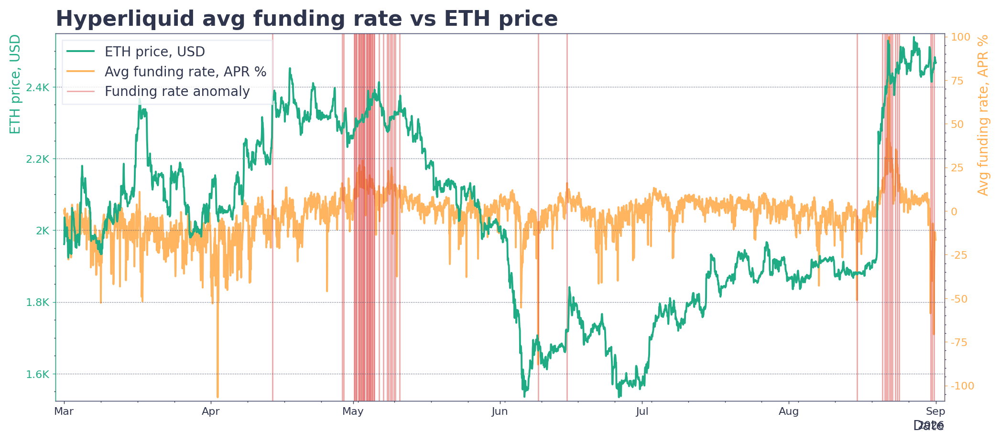

## Definition

**Hyperliquid Average Funding Rates** Anomaly monitors Hyperliquid's funding rates to detect anomalies when rates exceed predefined high/low thresholds.



## Covered assets

* All assets

## Use Cases

**Risk Management**

- Early warning for excessive leverage conditions
- Market stress detection before major price movements

**Trading Opportunities**

- Identify arbitrage opportunities from funding imbalances
- Optimize position timing based on funding cycles

**Market Analysis**

- Track liquidity conditions and market sentiment
- Monitor unusual market behavior for research/compliance

## SanAPI

Available under the `anomaly_hyperliquid_avg_funding_rate` name.

Example of query for the **raw signals** for all covered assets, including their metadata:

```graphql explorer
{
  getRawSignals(
    signals: "anomaly_hyperliquid_avg_funding_rate"
    from: "utc_now-30d"
    to: "utc_now"
    selector: { watchlistSlug: "projects" }
  ) {
    datetime
    signal
    slug
    value
    metadata
  }
}
```
